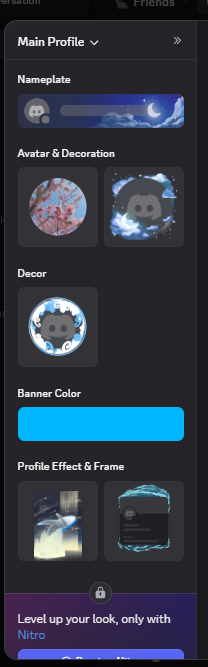
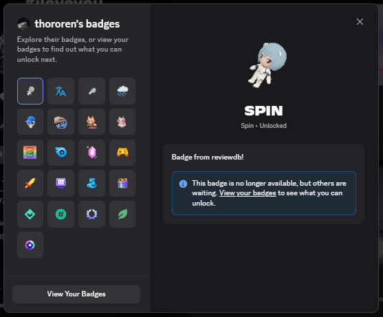
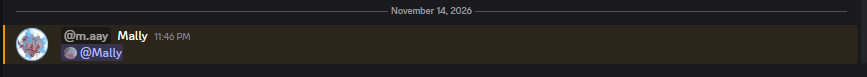
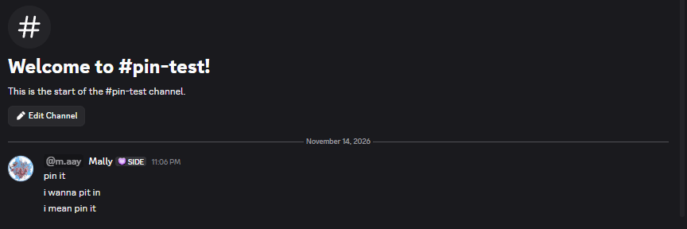
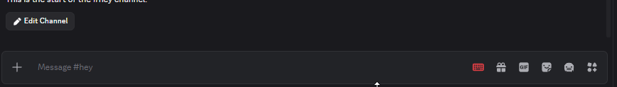
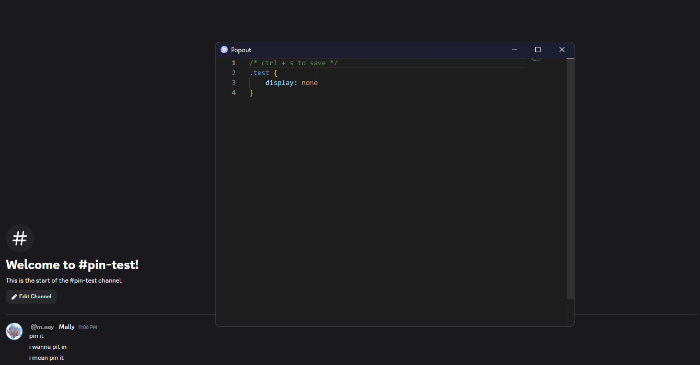

# Mally's shelter plugins

This library targets porting Equicord plugins to shelter. Mostly plugins here are either ported from shelter or forked existing plugins to make it better!

Install any plugin in shelter with `https://themallyguy.github.io/shelter-plugins/<plugin>/`, e.g. `https://themallyguy.github.io/shelter-plugins/decor/`.

# Plugins

| Plugin | Author | Description |
| --- | --- | --- |
| [Decor](#decor) | Mally | Bring decor to shelter |
| [Global badges](#global-badges) | Mally | Bring other client's badges to shelter |
| [Mention Avatars](#mention-avatars) | Equicord/Vencord, ported by Mally | Add the mentioned user's avatar next to the mention |
| [No pin prompt](#no-pin-prompt) | Equicord/Vencord, ported by Mally | Ignores the pin prompt and auto pins it |
| [Polish Wording](#polish-wording) | Equicord, ported by Mally | Tweaks your messages to make them look nicer and have better grammar |
| [Quick CSS](#quick-css) | Mally | Modify css like quickcss on Vencord! Powered by monaco-editor |
| [Show username](#show-username) | ioj4 & Mally | Show username right next to display name |
| [TimezoneDB](#timezonedb) | Mally | Timezones for shelter |
| [Trust worthy](#trust-worthy) | SpikeHD & Mally | Trust files, links |

## Decor

- Author: Mally
- Bring decor to shelter. **Only fully works if your client is set to English.**
- Install: `https://themallyguy.github.io/shelter-plugins/decor/`

## Global badges

- Author: Mally
- Bring other client's badges to shelter
- Install: `https://themallyguy.github.io/shelter-plugins/globalBadges/`

## Mention Avatars

- Author: Made by Equicord/Vencord, ported by Mally
- Add the mentioned user's avatar next to the mention
- Install: `https://themallyguy.github.io/shelter-plugins/mentionAvatars/`

## No pin prompt

- Author: Made by Equicord/Vencord, ported by Mally
- Ignores the pin prompt and auto pins it
- Install: `https://themallyguy.github.io/shelter-plugins/noPinPrompt/`

## Polish Wording

- Author: Made by Equicord, ported by Mally
- Tweaks your messages to make them look nicer and have better grammar
- Install: `https://themallyguy.github.io/shelter-plugins/polishWording/`

## Quick CSS

- Author: Mally
- Modify css like quickcss on Vencord! Powered by monaco-editor
- Install: `https://themallyguy.github.io/shelter-plugins/quickCss/`

## Show username

- Author: ioj4 & Mally
- Show username right next to display name in discord
- Install: `https://themallyguy.github.io/shelter-plugins/showUsername/`

## TimezoneDB

- Author: Mally
- Timezones for shelter
- Install: `https://themallyguy.github.io/shelter-plugins/timezoneDb/`

## Trust worthy

- Author: SpikeHD & Mally
- Trust files, links
- Install: `https://themallyguy.github.io/shelter-plugins/trustWorthy/`
